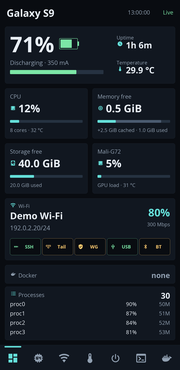
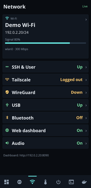
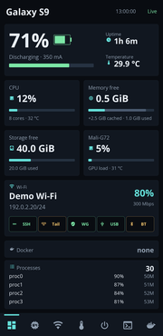
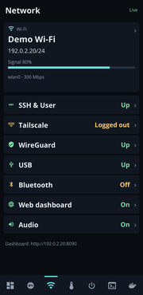
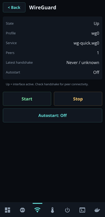
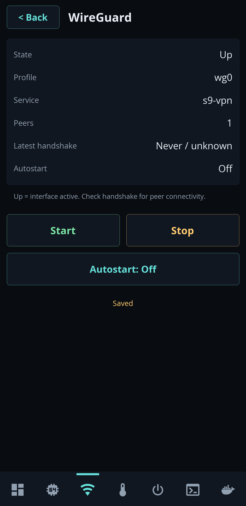

# WireGuard on the phone UI

The Network tab lists WireGuard immediately after Tailscale. Overview keeps its
existing metric cards and fits SSH, Tail, WG, USB and BT into the same network
card. Tap WG to open its detail page. Start, Stop and Autostart run on the UI's
worker thread, with a bounded helper timeout. Back returns to Network.

This is control of one administrator-provisioned profile, not a configuration
importer. It does not create keys, edit the VPN profile, install routes or modify
the firewall. No VPN is enabled merely by installing the UI.

## UI previews

**UI previews rendered with demo data; hardware validation separate.** These are
code-rendered previews, not physical screen captures. Network addresses and
device details are synthetic; both interface states are shown with autostart off.
Overview shows five mini-cards in the same network card: SSH, Tail, WG, USB, BT.

Click a thumbnail to open the full-size preview.

| State | Overview: five mini-cards | Network: below Tailscale | WireGuard controls |
| --- | --- | --- | --- |
| Down | [](screenshots/overview-down.png) | [](screenshots/network-down.png) | [](screenshots/wireguard-down.png) |
| Up | [](screenshots/overview-up.png) | [](screenshots/network-up.png) | [](screenshots/wireguard-up.png) |

### On-device and connectivity checks

The proposal based on main `943c125`, including the terminal selftest correction,
was installed and checked on a real SM-G960F on 2026-10-25. These checks are
separate from the six synthetic UI renders above.

<a href="screenshots/device-wireguard-up.png"></a>

*Unmodified 1440 × 2960 framebuffer capture from the S9. The interface was Up,
but this image was taken **before** the external handshake and traffic test;
it is not a screenshot of established VPN connectivity.*

| Check | Observed result |
| --- | --- |
| Physical touch operation | Start → Up, Stop → Down and Back verified on the touchscreen; 14 touch events recorded |
| Helper and dashboard API | Matching interface state and latest handshake timestamp |
| Autostart | Repeated On/Off requests and reboot checks exercised |
| Stop behavior | Four further instrumented cycles passed; already-Down and stale-DNS-guard cases also passed |
| External mobile access | A separate phone with Wi-Fi disabled used its mobile connection to reach the VPN over the public network |
| Handshake and traffic | Fresh handshake; receive/transmit counters reached 108,796 / 1,468,836 bytes during the external check |
| HTTPS application | The expected application page loaded through the VPN without a certificate warning |
| Separate host compatibility check | USB/RNDIS networking and key-authenticated SSH verified from Windows 11 Pro build 26300, using the automatically enumerated Remote NDIS driver |

Helper error and timeout checks remain enabled.
Interface Up alone still does not establish connectivity: the separate
handshake, traffic and application checks supply that evidence here.

Both an administrator-provisioned OpenRC wrapper and the distribution's named
`wg-quick.wg0` instance were checked on the S9. The stock instance passed
configured Down, Start → Up, Autostart On/Off and Stop → Down, all with exit
status zero. The change preserves main's idle/sleep and
low-battery chime behavior.

## Provisioning

The s9-server package depends on `wireguard-tools` (the `wg` and `wg-quick`
tools), `wireguard-tools-openrc` (the distribution's init script), and
`wireguard-go` (userspace fallback). It also includes `iproute2` for JSON link
status and `sudo-virt`, a `sudo` command provider dependency for the dashboard's read-only helper call.
The package accepts the distribution's existing `sudo` or `sudo-rs` provider
instead of forcing a conflicting replacement. `wireguard-go` is
needed when the S9's older kernel has no native WireGuard support. Upstream
`wg-quick` can fall back to that executable when kernel interface creation is
unsupported; no kernel module installation or flashing is performed here.

Dependencies are obtained from the target distribution's repositories; no
third-party binaries or WireGuard source are bundled. Ensure the matching
Alpine `main` and `community` repositories are available for the device's
release. The [Alpine package metadata](https://pkgs.alpinelinux.org/package/edge/main/aarch64/wireguard-tools)
documents the tools meta-package, and the [Alpine setup guide](https://wiki.alpinelinux.org/wiki/Configure_a_Wireguard_interface_%28wg%29)
documents the separate OpenRC package and named service instance.

### Commission a fresh installation

Package installation leaves the UI **Unconfigured**. It supplies tools and the
public settings example, but no keys, VPN profile, named service instance or
automatic VPN activation. On a fresh installation, first create the profile
directory as root:

```sh
install -d -o root -g root -m700 /etc/wireguard
```

Provision `/etc/wireguard/wg0.conf` through a secure local editor or existing
provisioning system. Do not place private keys in shell arguments, logs, the UI
or this repo. Once the profile exists, run these commands as root:

```sh
chown root:root /etc/wireguard/wg0.conf
chmod 600 /etc/wireguard/wg0.conf
test -x /etc/init.d/wg-quick
ln -s /etc/init.d/wg-quick /etc/init.d/wg-quick.wg0
install -d -o root -g root -m755 /etc/s9
test ! -e /etc/s9/wireguard && test ! -L /etc/s9/wireguard
install -o root -g root -m600 /usr/share/s9-server/wireguard.conf.example /etc/s9/wireguard
/usr/local/sbin/s9-wireguard status
```

Run these commands individually; stop if an existing alias/settings file is
found and inspect it rather than replacing it. The default profile is `wg0`
and the default service is `wg-quick.wg0`. Root-owned service symlinks are
accepted only when their resolved target and all ancestor directories are
trusted. The UI should now report **Down** with autostart off. Start explicitly
from the phone UI, then check the interface and a recent peer handshake. Enable
Autostart separately only when wanted; provisioning does not add a runlevel link.

Only `PROFILE` and optional `SERVICE` are accepted in `/etc/s9/wireguard`; it is
parsed as data, never sourced. An administrator may select an existing custom
root-owned OpenRC service instead of the distribution's default, for example:

```ini
PROFILE=wg0
SERVICE=my-vpn
```

The matching profile, config, service, resolved service target and their
ancestors must be root owned and not writable by group or others. Missing or
untrusted configuration produces **Unconfigured** and refuses control actions.
The helper checks profile metadata and never opens the profile file.

## Install map

The s9-server package stage installs the helper and sudo rule automatically.
For an existing installation, copy these files locally on the phone as root:

| Source | Destination | Mode |
| --- | --- | --- |
| `display/display.py` | `/usr/local/lib/s9-display/display.py` | 0755 |
| `dashboard/services.py` | `/opt/s9-dashboard/services.py` | 0644 |
| `wireguard/s9-wireguard` | `/usr/local/sbin/s9-wireguard` | 0755 |
| `wireguard/sudoers` | `/etc/sudoers.d/s9-wireguard` | 0440 |
| `wireguard/config.example` | `/usr/share/s9-server/wireguard.conf.example` | 0644 |
| administrator's settings | `/etc/s9/wireguard` | 0600 |

Keep the helper and its ancestor directories root owned and not writable by
unprivileged users. Validate the sudo rule using `visudo -cf` before activating
it. Restart `s9-dashboard` and `s9-display` after installing the files. The
generic `display/deploy.sh` deploys display files only; use the package or the
complete map above to enable WireGuard status/control.

The framebuffer UI runs as root and can invoke the fixed helper actions. The
dashboard UID 10000 is granted **only** the exact `s9-wireguard status` command,
not start/stop, arbitrary arguments or general WireGuard access. Its collector
publishes `services.wireguard`. This change adds no web control endpoint.

## Status and verification

`Up` means the configured interface has its UP flag; it is not proof of working
VPN traffic. The page separately reports peer count and latest handshake age.
`Down` means the interface is absent or down. `Unknown` means status could not
be read. An absent helper/sudo permission gives Unknown rather than Down.

Status runs only `ip -j link` and `wg show PROFILE latest-handshakes`; it does not
use `wg show dump`, `showconf`, or a private-key selector. Public keys from the
handshake response are discarded; the JSON contains only profile/service names,
state, autostart, peer count and handshake timestamp. Service output is never
relayed to the screen or dashboard, including on failure.

Before relying on the controls, verify as the dashboard user that
`sudo -n /usr/local/sbin/s9-wireguard status` returns JSON. Inspect privileges
with `sudo -n -l /usr/local/sbin/s9-wireguard start` without invoking an action;
the supplied rule grants no such permission, but broader existing sudo rules
must also be considered. Then test
Start, Stop, Autostart and Back on the phone. Starting/stopping a VPN may change
the active remote-access route; verify from a local console. A service action
returns within 15 seconds (the UI's outer limit is 18 seconds). A timed-out
OpenRC action may still have changed the interface; refresh status before
retrying. Custom services should also bound their own child processes.
Autostart requests are idempotent: a trusted runlevel link already in the desired
state succeeds without invoking `rc-update`. A changed link is checked again
after `rc-update`; conflicting or untrusted entries are refused. Start/Stop
service errors are still reported as errors.

Offline checks:

```sh
python3 -m unittest discover -s tests -v
python3 display/display.py --selftest
python3 dashboard/services.py
```

The UI tests require Linux and Pillow. They use a local DejaVu font fallback,
never access a framebuffer or a real VPN, and exercise navigation, worker
queuing, disabled controls, layout bounds and all status renders. The display's
existing selftest requires its documented Open Sans/Nerd fonts (or an explicit
test-harness font override). Offline tests do not establish phone runtime or
VPN connectivity.

The terminal selftest checks that the maximum number of glyph cells fits the
viewport, allowing for the installed font's actual advance width. It preserves
the existing row counts and does not change terminal sizing in production.
Install `pyte` to exercise the terminal emulator checks. Run the renderer with
the device fonts and selftest enabled:

```sh
python3 tests/render_wireguard.py --selftest --fonts FONT_DIRECTORY OUTPUT_DIRECTORY
```

No assertion rewriting or selftest bypass is used.
### Qualification results

The qualified build passed **27 tests** with the device fonts and `pyte`
enabled. The terminal emulator passed **65 assertions at two scales**. The
installed runtime was Python 3.14.8, Pillow 12.3 and pyte 0.8.2; the device's
selftest and terminal checks also passed after real reboots.

The former fixed landscape-column expectation was replaced by an invariant:
the maximum cell count must fit the viewport at the actual glyph advance.
This changes the selftest only; production terminal-sizing code is unchanged.
The renderer's former in-memory assertion workaround was removed, and no
terminal-emulator checks were skipped for this qualification.

A real aarch64 `abuild` produced `s9-server-1-r2.apk` from LF-normalized Git
sources. All **421 packaged entries** matched the expected package content,
and the packaged helper was executed. Package SHA-256:

```text
d4b8da506a8d93de485261928667632a1fb7e6de2bb3465c88d64acfab4ae657
```

The package was installed on the S9 over `1-r1`, preserving configuration,
using `apk add --no-scripts --no-network --allow-untrusted` with the local APK.
The dependency uses `sudo-virt` to accept the installed sudo provider; this
avoids the observed conflict between explicitly requiring `sudo` and an
existing `sudo-rs` installation. The local qualification APK is not presented
as a signed release image.
